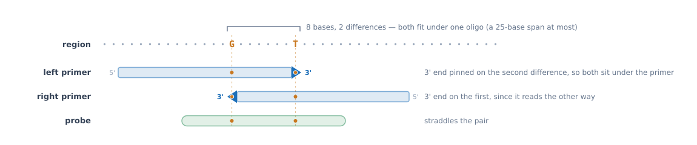

# Designing assays

`primer-finder find` reports **regions**. `primer-finder design` turns them into **assays**: it runs Primer3
on the regions of a finished run, works out what would make each assay selective, and writes the primer
files that [insilicoPCR](https://github.com/duceppemo/insilicoPCR) reads — optionally running it as well, to
check the assays against both groups of genomes.

```bash
primer-finder design results/ -o assays/ -t 16
primer-finder design results/ -o assays/ -t 16 --insilico-pcr /path/to/insilicoPCR-linux-x64
```

The genomes come from what the run recorded in `run_info.json`, so the two folders need not be given again;
`-i` and `-e` override that if they have moved.

## What makes an assay selective

A region is inclusion-specific as a whole: every kmer of it is absent from the exclusion genomes. **An assay
designed inside it is not specific by itself.** Only two things make it so, and the command tells them apart:

1. **Absence.** The amplicon does not exist in any exclusion genome, so there is nothing to amplify. This is
   the strongest case and it is how the published assays this tool is
   [validated](Validation) against work — their oligos cover no differing base at all; the stretch they sit
   in is simply missing from the other subspecies.
2. **Differences.** The amplicon does exist there, but an oligo sits on bases that differ — the lower-case
   bases of `final_kmers.fasta`. The assay then depends on a mismatch stopping the reaction.

An assay that is neither — amplicon present, no oligo on a difference — would amplify both groups. Those are
listed in `assays.tsv` with `specific_by=nothing` and go no further.

## How Primer3 is asked

Three kinds of request go in for each region, and the results are pooled and de-duplicated:

| Request | What it asks for | Why |
|---|---|---|
| plain | the best assay anywhere in the region | the region may be absent from the exclusion genomes, in which case any assay in it works |
| `SEQUENCE_FORCE_LEFT_END` / `SEQUENCE_FORCE_RIGHT_END` | a primer whose 3' end sits on the last (or first) difference of a target | allele-specific PCR: a mismatch at the 3' end hinders extension, and the rest of the target falls under the primer |
| `SEQUENCE_INTERNAL_OVERLAP_JUNCTION_LIST` | a probe straddling the middle of a target | a probe that cannot bind the exclusion template |

A **target** is a stretch of at most 25 bases — the widest primer Primer3 may return — holding as many
differences as possible — the richest first, then the narrowest, then the leftmost, with the differences of
each taken out before the rest are measured again so that a pair beside a richer target still gets one. The
four richest, non-overlapping ones are aimed at. See
[below](#spending-the-differences-on-one-oligo) for why that is the unit rather than a run of consecutive
differences.

A region's marked bases are of two kinds, and only one of them is a target. Most *differ* from the
exclusion genomes; a stretch may instead be **missing** from all of them, which `find` records in
`run_info.json` because the sequence cannot tell them apart. An absent stretch is marked in full, so it is
almost always the richest window a region holds — a 300-base block beats any pair of differences — and it
took every forced request the region had, leaving the differences it was kept for unaimed at. It is not
aimed at now: an oligo there is not discriminating by a mismatch but sitting on sequence the exclusion
genomes do not have, which the amplicon check decides and `specific_by absence` reports, wherever in the
region the oligos land. A run recorded before 1.9.1 has no such record and is aimed at as before.

The forced requests often come back empty, which is not an error: no oligo of the required length and
melting temperature may fit there. **A forced request cannot produce a bad oligo** — the constraints below
are part of every request, forced or not, apart from the GC clamp (which cannot be, see below), and Primer3
returns nothing rather than something outside them.

### Spending the differences on one oligo

This is the point the whole pipeline turns on, so it is worth stating plainly. `primer-finder find` keeps a
region when its differences from an exclusion genome **could sit in one oligo** — a run of them, or two of
them at most 23 matching bases apart, which is a span of 25 bases counting the differences themselves: the
widest primer Primer3 may return
([Methods](Methods#3-the-differences-worth-an-assay-minimap2)). A region is selected for that and nothing else; the whole
reason it is a candidate is that an oligo can be placed to carry two or more mismatches at once.

Drawn — a region with two differences seven bases apart, which is not a run but is well within one oligo:

<p align="center">
  
</p>

Up to 1.3.0 there was no target here at all: two differences seven apart are two runs of one, so a request
pinned a 3' end on `G` **or** on `T`, and whichever primer came back carried a single mismatch.

So the design step has to actually do it, and two things make sure of it:

1. **The forced requests aim at a window, not at a run.** Two differences seven bases apart are not
   consecutive, so a run-based target would see two runs of one and pin a primer's 3' end on a single base,
   wasting the pair the region was kept for. On the *Xylella* validation set that is the usual case: 19 of
   the 20 regions designed on hold such a pair, and 8 hold nothing else. Aiming at any 25-base window
   instead raised the share of difference-based assays whose best single oligo covers two or more
   differences **from 43% to 77%**, on the same regions with everything else unchanged.
2. **`--min-primer-differences`, 2 by default, sets aside the rest.** An assay that rests on differences
   and spends only one of them is the weak case the `find` rule exists to avoid — a single mismatch, even at
   a 3' end, often does not stop amplification
   ([Lefever et al. 2019](https://doi.org/10.1038/s41598-019-38581-z)). Those assays are still listed, with
   `best_primer_variants` saying how many the better primer carries, but they are not written to the
   insilicoPCR files and not carried further. `--min-primer-differences 1` asks for only one difference
   under a primer, which is a weaker assay rather than no assay — but still a difference under a *primer*,
   so an assay whose only differences are under its probe is set aside at any setting above 0.
   `--min-primer-differences 0` turns the filter off altogether and accepts those too.

An assay that is **specific by absence** is exempt: it does not rest on a difference at all, so how many
sit under its primers is beside the point. That exemption, and the top ranking tier that goes with it, is
only as good as the rule deciding an exclusion genome does not hold the amplicon.

### When an exclusion genome counts as holding the amplicon

The amplicon is blasted against each exclusion genome, and a hit counts as "this genome has it" when it
**reaches at least 90% of the amplicon** and **at least 90% of the bases that align match**. Neither is
what blast reports in its `length` and `pident` columns, and the difference matters in one common case: an
insertion in the amplicon that the exclusion genome does not carry.

Blast reports such a hit one of two ways, depending on how its scores fall, and the bundled example --
whose inclusion group carries a planted 15-base insertion -- produces both:

* **Gapped through the insertion.** `pident` counts the gap columns as mismatches, so an exclusion genome
  holding the whole amplicon bar the insertion reads as 87% identity. Judged that way it looked not to
  hold the amplicon at all, while in fact holding both primer sites exactly. Identity is therefore
  measured over the columns where both sequences have a base.
* **Stopped at the insertion.** The hit then really does reach only part of the amplicon, and that is a
  genome where a primer site falls inside the insertion and so is genuinely missing. Coverage is therefore
  measured over how much of the amplicon the hit *reaches*, not over the length of the alignment, which
  the gap columns inflate.

A long insertion between the primers still counts as held. The product would be the wrong size, and in a
real reaction quite possibly no product at all — but that is a claim about a reaction rather than about the
sequence, so the assay is sent to be judged on how its primers differ instead of being granted the
"nothing to amplify" exemption. Erring that way costs a good assay its top tier; erring the other way
hands the top tier to an assay whose primer sites are present in every exclusion genome.

### A copy blast reports in pieces

Blast does not always report a copy as one alignment. Once the cost of gapping through an indel exceeds
what the rest of the alignment is worth it stops and reports the stretches either side separately —
measured with blastn 2.17 at its defaults, an insertion of about 60 bases does it on a 207-base amplicon,
and a deletion of about 30. Each piece on its own reaches only part of the amplicon, so a genome holding
every base of it either side of an insertion, and both primer sites exactly, counted as holding nothing.

Pieces are therefore joined back together first. Two of them belong to the same copy when they follow each
other both in the amplicon and in the genome, on one strand of one sequence, no more than 2,000 bases apart
in either — and the reach is then measured across the whole chain. Two copies lying side by side in the
genome do not join: the second repeats the amplicon rather than continuing it.

### An end blast stopped short of

Blast will not always pay its gap costs to carry an alignment across an indel for the sake of a few bases,
so it can report a hit that stops short of the amplicon's ends although the genome holds them. Measured on
real output: a 72-base amplicon whose first eight bases sit either side of a one-base insertion and a
one-base deletion came back as `q9-72` — 88.9% of the amplicon, just under the coverage rule — while
megablast aligned all 72 and called it a copy. There is one alignment there, so the chaining above has
nothing to join.

Each unaligned end is therefore compared, base for base, against the stretch of genome it would have to
occupy, and added to the chain as the piece blast did not report — columns and mismatches alike, so a flank
the genome does not hold still fails the rule on its own evidence. It is consulted **only** for a chain
that fell short, never to reconsider a copy that blast's own evidence reaches, so it can shed an unearned
`absence` but never create one.

Comparing it in place rather than aligning it is deliberate. An aligner maximises over every way of
placing a short sequence, and with gaps to spend it finds half of any fifteen bases in any other: aligning
the flank turned eight of the bundled example's eleven genuine absences into copies. A flank is a handful
of bases that either sit where they have to or do not.

### The product the genomes would actually give

`product_size` is Primer3's: the span of the two primers in the **region**. The region is a stretch the
kmers of the find run spell out, and that is not always a stretch any genome holds at that length — at
`-d 1` a region spliced across a tandem repeat carries fewer copies of it than the genome does (see
[Methods](Methods#a-region-held-in-pieces)). So every copy counted in an inclusion genome is also
*measured* there, from the first base of one primer site to the last of the other, and reported as
`inclusion_product_span`: one number, or `low-high` where the genomes differ.

Where the two disagree the run says so, once, naming the worst assay. An indel between the primers does
the same thing on a smaller scale, and `has_the_amplicon` counts such a genome as holding the amplicon on
purpose — that is a claim about sequence rather than about a reaction — so this column is what that
decision leaves unsaid. It is the number to check before ordering anything whose size matters.

### What the search itself cannot see

Two more things can hide a copy, and both are looked at again for the genomes that came back with none —
only ever to shed an `absence`, never to create one:

- **the e-value floor.** `-evalue 1e-10` is a floor of 32 to 34 bases whatever the query length, so in a
  70-150 base amplicon the primer-sized pieces that decide the answer are invisible: a 90-base amplicon
  with a 30-base deletion between the primers returns no hit at all, while the genome holds both primer
  sites and would make a shorter product. Such a genome is searched again at `-evalue 1` and counted as
  holding a copy when the two primer sites are there in one place, the right way round and close enough to
  be a product;
- **the low-complexity masking.** `blastn` masks a low-complexity query by default, and a masked amplicon
  is not found however exactly the genome holds it — measured on a 200-base AT element planted in a 6 kb
  genome, no hit at the default and a 100%, full-length hit with `-dust no`. That second search runs with
  the masking off for the same reason, and [Methods](Methods#what-the-masking-hides) has the measurement
  behind it.

> **Changed in 1.8.0 and 1.8.1.** Before 1.8.0, coverage and identity were taken from blast's own `length`
> and `pident`, and each piece was judged on its own. The counts quoted from the sweeps on this page and in
> `validation/results/` were produced under the old rule. On the bundled example the fix moves 7 of the 18
> assays that claimed absence into `difference`, where all 4 exclusion genomes are recorded as holding the
> amplicon, and leaves the other 11 as they were. 1.8.1 added the end-of-amplicon comparison above, which
> leaves those 11 as they were too.

### Why the probe does not count towards it

`--min-primer-differences` looks at the **primers only**, however many differences the probe covers. That is
deliberate, and it is the one place where the reasoning behind this filter does not carry over from a primer
to an oligo in general.

A probe here is longer than a primer — 18 to 27 bases against 18 to 25, 22 optimal against 20 — and its
melting temperature is higher, 62–72 °C against 58–63 °C, because the extra length is how that temperature
is reached. In a reaction annealing near 60 °C it therefore starts with far more binding energy in hand, and
two mismatches spread over a long duplex need not stop it hybridising or being cleaved. Three findings say
so more precisely than the argument does:

- **A conventional TaqMan probe still gave a detectable signal through five mismatches**, and under standard
  conditions neither it nor an MGB probe was sequence-specific
  ([Yao, Nellåker & Karlsson 2006](https://doi.org/10.1016/j.mcp.2006.03.003)). Whatever a small number of
  mismatches under a probe is evidence of, it is not evidence of discrimination.
- **A probe discriminates by being short, not by carrying more mismatches.** A 12-base MGB probe has the
  same melting temperature, 65 °C, as an unmodified 27-base one (Kutyavin et al. 2000, *Nucleic Acids Res*
  28:655–661, [PMC102528](https://pmc.ncbi.nlm.nih.gov/articles/PMC102528)). Shortening the duplex is what
  makes one mismatch a large fraction of its stability, which is why SNP genotyping uses short MGB or LNA
  probes with the difference near the middle.
- **In a 5'-nuclease assay the discrimination lives in the primers.** A single mismatch in a primer's 3'
  region shifts the quantification cycle by anything from under 1.5 to over 7 cycles depending on which base
  pair it is, and by up to sevenfold between master mixes
  ([Stadhouders et al. 2010](https://pmc.ncbi.nlm.nih.gov/articles/PMC2797725); see also Lefever et al.
  2013, *Clin Chem* 59:1470–1480). The probe reports the amplification; it does not gate it.

So an assay whose only differences sit under its probe is set aside like any other that no primer can tell
apart. Its probe differences are still counted in `probe_variants`, and they still break ties in the
ranking (step 8), but they cannot qualify it.

**If the probe is meant to do the discriminating**, primer-finder cannot give you what that needs: order it
as a shortened MGB or LNA probe with the difference near its centre, and raise the annealing temperature.
What the design step can do is stop presenting a 27-mer as though it were specific.

#### What this evidence does not settle

- Yao et al. is one study, one target, from 2006, under "standard conditions". "A detectable signal" is not
  the same as "indistinguishable": a probe mismatch that delays the cycle by several cycles may still
  discriminate if you set a threshold for it and validate that threshold.
- Every number above is condition-dependent. Stadhouders' sevenfold spread between master mixes is the point
  rather than a footnote: the same oligo behaves differently in a different mix, at a different annealing
  temperature, with a different polymerase.
- **In silico PCR cannot settle it either way**, in either direction. It decides whether an oligo binds by
  counting mismatches, so it will report a probe with two mismatches as not binding — which is exactly the
  assumption in question. In the *Xylella* sweep every one of the 58 probe-only assays came out "selective"
  in qPCR mode and none of them in PCR mode; that gap was the model trusting the probe, not evidence about
  it.

So this is a reason to stop treating two mismatches under a probe as qualification, not a demonstration that
such a probe never discriminates. `--min-primer-differences 1` accepts those assays if you would rather
judge them yourself.

On the *Xylella* set the two changes together take the 511 assays Primer3 proposed to 363 carried forward
(195 by absence, 168 by difference), setting 141 aside and dropping the 7 that would amplify both groups. The ranking is unchanged: it still prefers more
differences in total, and does not take a view on whether two under one primer beat one under each.

## What an oligo has to satisfy

These are **hard constraints**, not score terms: Primer3 returns nothing rather than an oligo outside them,
so an oligo outside them is never proposed and never reaches the ranking. The ranking below only ever
orders assays that already satisfy all of this. What it does not mean is that an assay inside the limits
will work, or that one outside them would not: two of the four published *Brucella* assays
[in the validation suite](Validation) carry an oligo over the hairpin limit and are validated on 427
strains.

| | Primer | Probe |
|---|---|---|
| Length | 18–25 nt, 20 optimal | 18–27 nt, 22 optimal |
| Melting temperature | 58–63 °C, 60 optimal | 62–72 °C, 68 optimal |
| GC | 30–70% | 30–80% |
| Ambiguous bases | none | none |
| G or C at the 3' end | `--gc-clamp`, 1 by default, except in a request that pins an end | — (Primer3 has no clamp for the probe) |
| Hairpin | melts below `--max-hairpin-tm`, 47 °C by default | same |
| Self-dimer, whole oligo and 3' end | below `--max-dimer-tm`, 47 °C by default | same |
| Dimer with the other primer, whole oligo and 3' end | below `--max-dimer-tm` | — |

### The 3' end: `--gc-clamp`

A G or a C at the 3'-most base holds the primer down where extension starts, so one is asked for by default
(`PRIMER_GC_CLAMP=1`); `--gc-clamp 2` asks for two, `--gc-clamp 0` for none.

**The clamp is dropped from the requests that pin a primer's 3' end on a differing base.** Those are the
`SEQUENCE_FORCE_LEFT_END` / `SEQUENCE_FORCE_RIGHT_END` requests, where the 3' base is whatever the genomes
made it — asking for a G or a C there is asking for a difference that may not exist. On an A/T-rich target
the two requirements are almost never satisfiable at once: with the clamp left on, seven of eight forced-end
requests on the *Xylella* set returned nothing.

`PRIMER_GC_CLAMP` is a single tag for a whole request, with no per-side or per-oligo variant, so dropping it
drops it from **both** primers of such a request — the partner, whose end Primer3 was free to choose, loses
it too — and `--gc-clamp` therefore reaches only the requests that pin nothing and the one that pins the
probe. There is no way to ask Primer3 for "a clamp on the partner but not on the pinned primer". The clamp
never applies to the probe either: Primer3 has no `PRIMER_INTERNAL_GC_CLAMP`.

### Hairpins and dimers

An oligo that folds back on itself, pairs with a copy of itself, or pairs with its partner is spent before it
ever reaches the template — and a 3'-end dimer is worse than an internal one, because the polymerase can
extend it. Primer3 models all of these thermodynamically (`PRIMER_MAX_HAIRPIN_TH`, `PRIMER_MAX_SELF_ANY_TH`
and `_SELF_END_TH`, `PRIMER_PAIR_MAX_COMPL_ANY_TH` and `_COMPL_END_TH`, and the `PRIMER_INTERNAL_*`
equivalents for the probe), and the design step sets every one of them, for the probe as well as the primers.
Nothing extra has to be installed: this is Primer3's own thermodynamic alignment, so there is one melting
temperature model for the oligo and for the structures it might form.

The default limit of 47 °C is Primer3's own, which is roughly 10 °C below the annealing temperature these
oligos are designed for: a structure that has melted by the time the reaction anneals does not compete with
the template. Lower it to be stricter (`--max-hairpin-tm 40`), raise it on a target where nothing else will
fit — at the cost of candidates that may fold.

What Primer3 predicted is **also reported**, so a reaction run under other conditions can be judged:
`pair_dimer_tm` and `pair_dimer_end_tm` per assay, and `forward_hairpin_tm`, `forward_self_dimer_tm` and the
`reverse_` and `probe_` equivalents per oligo. A `0.0` means no structure was predicted, not that none was
looked for.

### The reaction those temperatures are predicted for

A melting temperature is only meaningful for a given reaction: salt stabilises a duplex, magnesium more so
per mole, dNTPs chelate magnesium away, and oligo concentration shifts the equilibrium. Primer3 is therefore
told what reaction to predict for, and the defaults are an ordinary TaqMan qPCR:

| Option | Default | Primer3 tag |
|---|---|---|
| `--monovalent` | 50 mM | `PRIMER_SALT_MONOVALENT` |
| `--divalent` | 3 mM Mg²⁺ | `PRIMER_SALT_DIVALENT` |
| `--dntp` | 0.8 mM total (0.2 mM each) | `PRIMER_DNTP_CONC` |
| `--primer-conc` | 250 nM | `PRIMER_DNA_CONC` |
| `--probe-conc` | 200 nM | `PRIMER_INTERNAL_DNA_CONC` |

The probe gets its own concentration, since it is normally used below the primers. These are not cosmetic:
they change both the temperatures reported and which oligos come back at all. Measured on the first assay of
the *Xylella* run, the same oligos read:

| | bare Primer3 defaults | the reaction above | its floor here |
|---|---|---|---|
| its forward primer | 56.1 °C | 60.0 °C | 58 °C |
| its probe | 54.6 °C | 64.0 °C | 62 °C |

Either oligo is rejected under the bare defaults and accepted under the stated reaction, so this is not a
cosmetic difference in a reported number: it decides what Primer3 returns.

**Set them to your own master mix** if it differs; the values used are recorded in `design_info.json` under
`parameters.conditions`, so a table of assays can always be traced back to the reaction it was designed for.
Changing them does not change the oligos' behaviour at the bench, only which ones this step proposes.

## The scoring scheme

The order is a **heuristic for which assays to look at first**, not a prediction of what will work at the
bench. Nothing here has been tested in a laboratory. Read it as "these are the ones worth trying", and let
in silico PCR and then the bench decide.

Assays are ordered by this key, each step breaking the ties of the one before:

1. **Absence beats everything.** An assay whose amplicon no exclusion genome holds has nothing to amplify
   there. This is the one step that does not depend on how a reaction behaves.
2. **How many differences the primers cover, in total.**
3. **What those differences replace**, weighted: a position where the exclusion genomes have a G or a C
   counts 1, an A or a T counts 0.5, and one whose base is not known counts 0.75. G and C pair with three
   hydrogen bonds against two, so a mismatch there costs more to form. This only ever separates assays that
   cover the same number of differences.
4. **The longest run of differences ending at a primer's 3' end.**
5. **Differences within five bases of a 3' end**, run or not.
6. **Primer3's pair penalty, by band** (<1, <2, <4, worse), so that a probe covering more differences never
   wins over an assay that is clearly better made.
7. **Copies of the amplicon in the inclusion genomes**, since a repeated target usually gives a better limit
   of detection. See [below](#repeated-targets-and--d).
8. **Differences under the probe**, then the exact penalty, then the names, so that a run is reproducible.

### The cases, drawn

Nine assays, all with the same Primer3 penalty so that only the differences separate them. Each row is a
20-base forward primer written 5' to 3', with `▶` for the 3' end where the polymerase extends:

```
 ·   a base the exclusion genomes share with the region — nothing for an oligo to discriminate on
 G   a base where they differ, written as what THEY have there: the base the primer would mismatch
 ▶   the 3' end of the primer                 ◀   the 3' end of the reverse primer, which reads the other way
```

In the order the ranking puts them. The three marked `no` are set aside before the order matters, so
`assays.tsv` writes them at the end of the file whatever their rank:

| | the primer | diffs | weight | 3' run | kept? |
|---|---|---|---|---|---|
| **1** | *the amplicon is missing from every exclusion genome* | — | — | — | yes |
| **2** | `·················GCG▶` | 3 | 3.0 | 3 | yes |
| **3** | `··················GC▶` | 2 | 2.0 | 2 | yes |
| **4** | `···················G▶` and `◀C···················` | 2 | 2.0 | 1 | **no** |
| **5** | `················G·C·▶` | 2 | 2.0 | 0 | yes |
| **6** | `·····G······C·······▶` | 2 | 2.0 | 0 | yes |
| **7** | `··················AT▶` | 2 | 1.0 | 2 | yes |
| **8** | `···················G▶` | 1 | 1.0 | 1 | **no** |
| **9** | *no difference under either primer; two under the probe:* `··········GC··········` | 0 | 0 | 0 | **no** |

Reading the ladder:

- **1 beats everything.** Nothing to amplify is better than something hard to amplify, and it is the only
  step that does not depend on how a reaction behaves.
- **2 beats 3** on the count alone: three differences under one primer rather than two.
- **3 beats 7** — the one your eye should go to. Both are a run of two at the 3' end; 3's are over a G and
  a C, 7's over an A and a T. Breaking G:C costs three hydrogen bonds against two, so at an equal count the
  G/C pair is worth more (step 3 of the key).
- **5 and 6 also beat 7**, which is the step order showing its hand: *what* the differences replace (step 3)
  is weighed before *where they sit* (step 4). Two G/C differences in the middle of a primer therefore
  outrank two A/T differences at its 3' end. 5 beats 6 because its differences are within five bases of the
  3' end even though neither reaches it (step 5).
- **9 comes last**, and is set aside: its primers cannot tell the groups apart at all. Two differences under
  a probe are not evidence that the probe will not bind — see
  [why the probe does not count](#why-the-probe-does-not-count-towards-it).

### The three that are set aside

Rows **4**, **8** and **9** are listed in `assays.tsv` but carried no further — not written to the
insilicoPCR files, not among the candidates — because of
[`--min-primer-differences`](#spending-the-differences-on-one-oligo), 2 by default:

- **8** rests on a single difference. One mismatch, even at the 3' end, often does not stop amplification.
- **4** is the subtle one. It covers **two** differences and its rank key is high — higher than 5, 6 and 7 —
  but they are one each on two different primers, so **neither primer carries two**. The region was kept
  because two differences could sit in *one* oligo, and this assay does not do that. The filter is applied
  before the order matters, so a high rank does not save it.
- **9** has two differences under one oligo, but that oligo is the **probe**, which does not count:
  [here is why](#why-the-probe-does-not-count-towards-it).

All three are kept in the table with `best_primer_variants` saying what they rest on.
`--min-primer-differences 1` accepts rows 4 and 8 — a weaker assay rather than no assay — but not row 9:
one difference under a *primer* is still asked for at any setting above 0. `--min-primer-differences 0`
turns the filter off and accepts row 9 as well.

Row **1** is exempt from the filter: an assay specific by absence rests on no difference at all, so how many
sit under its primers is beside the point.

### Why that order, and how much to trust it

Steps 2 to 4 follow common practice in allele-specific design rather than any measurement made here:

- a single mismatch, even at the 3' end, is often not enough on its own. Allele-specific PCR is known for
  "low discriminating power", and a common remedy is to introduce a **second, artificial mismatch** in the
  primer — the basis of double-mismatch allele-specific qPCR
  ([Lefever et al. 2019](https://doi.org/10.1038/s41598-019-38581-z)). More differences under a primer is
  the same idea, arrived at without having to engineer one;
- *where* a mismatch sits, and **which bases are involved**, changes its effect
  ([Sharma et al. 2022](https://doi.org/10.1016/j.jmoldx.2022.08.005) summarise this for PCR while
  characterising it for RPA). Hence two tie-breaks: the 3' end is the position that matters most for
  extension, and a difference replacing a G or a C is worth more than one replacing an A or a T, since
  G:C holds with three hydrogen bonds and A:T with two.

The bases are read from the exclusion genomes' own alignments of each amplicon, so what is weighed is what
an oligo would actually have to mismatch, genome by genome, rather than what the region happens to carry.
`assays.tsv` reports the weight (`primer_variant_weight`) and the count of G/C positions per primer
(`forward_strong_variants`, `reverse_strong_variants`), so the order can be checked.

**How much a given mismatch costs depends on the assay, not only on the sequence**: annealing temperature,
polymerase, magnesium, cycling and template concentration all change it. A design that discriminates under
one set of conditions may not under another, and optimisation at the bench can recover an assay this
ranking puts low — or ruin one it puts high.

### What the in silico PCR numbers do and do not say

Running the designed assays through in silico PCR gives numbers that look like evidence for the order above.
They are weaker than they look, and are reported here only so that nobody mistakes them for more. On 287
difference-based assays from *Xylella fastidiosa* subsp. *multiplex* regions, against 17 exclusion genomes,
the share that amplified only the inclusion group rises with the number of differences under the primers:

| differences under the primers | 0 (probe only) | 1 | 2 | 3 | 4 or more |
|---|---|---|---|---|---|
| qPCR mode, selective | 43% | 36% | 60% | 64% | 94% |
| PCR mode, selective | 0% | 7% | 39% | 40% | 91% |

Three reasons not to read that as a result about PCR:

1. **It is close to circular.** in silico PCR decides whether a primer binds by counting mismatches against
   its own tolerance (`--mismatches`). More differences therefore means fewer reported hits almost by
   construction. The numbers describe the model's rule as much as the biology.
2. **The model cannot see a difference at the very 3' end** — the position the ranking cares most about.
   See the three zones [below](#what---mismatches-actually-governs). Assays whose only differences are one
   or two bases at a 3' end are reported selective in none of the 65 cases seen, at **any** tolerance,
   because those bases are not counted. That is a property of the alignment, and it is the one number from
   an earlier version of this page that has had to be withdrawn as evidence: it says nothing either way
   about whether such an assay would discriminate at the bench.
3. **It is one organism, one dataset, one set of parameters.** 25 genomes, 20 regions, one in silico tool.

So: the ranking is a sensible order to work through, supported by what others have published about
mismatches, and the in silico numbers are a consistency check on one dataset. They are not a measurement of
how these assays behave in a tube. The full sweep is in
[`validation/results/2026-10-08_v1.3.0/SUMMARY.md`](https://github.com/duceppemo/primer-finder/blob/main/validation/results/2026-10-08_v1.3.0/SUMMARY.md).

One thing in that record is **not** circular, and is worth acting on: of the 178 assays that are specific by
absence — no designed mismatch anywhere, their amplicon simply missing from the exclusion genomes — 30
amplify *something else* in an exclusion genome at the default tolerance, and 50 do at `--mismatches 2`.
Off-target amplification is a real specificity risk that has nothing to do with the ranking, and it is the
main reason to run the check at all.

## Checking the assays with in silico PCR

insilicoPCR is a separate program and stays one. `primer-finder design` writes what it reads, and will run
it for you:

```bash
primer-finder design results/ -o assays/ --insilico-pcr /path/to/insilicoPCR-linux-x64
```

`--insilico-pcr` takes the folder of an extracted portable release (which brings its own Java), its jar, or
a launcher script — **insilicoPCR 0.12.0 or newer**. Since 0.8.0 a row of its report is a called
amplicon: the two primers on the same contig, facing each other, within a size limit, and for a probe assay
with the probe inside the product. The report of an older release — whose rows were every pairing of two
primer alignments, most of them nothing PCR could make — is refused rather than counted; primer-finder
1.9.x carries the reading that re-checked them. The releases from 0.9.0 to 0.10.1 changed only
insilicoPCR's FASTQ mode, GUI and bundled BBTools: designed under 0.10.1, the *Xylella* panel gives the
same reports and the same verdict, assay for assay, as under 0.8.0
([`2026-11-07_v1.11.0_insilico0101/SUMMARY.md`](https://github.com/duceppemo/primer-finder/blob/main/validation/results/2026-11-07_v1.11.0_insilico0101/SUMMARY.md)).
0.11.0 adds an HTML report and product-size labels, and corrects the size it reports for a product whose
primer hangs off the start of a contig; the amplifications it reports are the same
([`2026-11-10_v1.11.0_insilico0110/SUMMARY.md`](https://github.com/duceppemo/primer-finder/blob/main/validation/results/2026-11-10_v1.11.0_insilico0110/SUMMARY.md)).
0.12.0 counts a mismatch near the end of a primer or a probe as one mismatch, where earlier releases
counted what blast trimmed off with it. That moves qPCR verdicts and what the 3'-end check sees, as the
sections below describe, so it is the oldest release primer-finder runs, and the report of an older one,
which lacks the two columns 0.12.0 added, is refused. 0.12.1 to 0.14.0 give the same results
([`2026-11-13_v1.12.0_insilico0130/SUMMARY.md`](https://github.com/duceppemo/primer-finder/blob/main/validation/results/2026-11-13_v1.12.0_insilico0130/SUMMARY.md));
releases up to 0.14.0 have been checked. Without `--insilico-pcr`, the same thing can be run later with
the `run_insilico_pcr.sh` the command writes, which asks the release its version first and runs nothing
on one older than 0.12.0.

**The primer files declare the product size.** The header of each forward primer carries the size the
assay was designed to give — `>Contig_1_67.5167_assay4-F size=78` — which insilicoPCR reads since 0.11.0. Its
report then ends with a `SizeCheck` column saying of every product whether it is that one (`target`,
within 10 bases of the size) or another (`unexpected`), and the `report.html` it writes beside each
report counts a sample as positive only on the first. It labels and removes nothing, and neither does
primer-finder: **a product of another size is still a product**, and on the exclusion group still a
cross-reaction, so the verdicts are counted exactly as before. A release from 0.8.0 to 0.10.1 reads the whole header as the primer's name, finds
no primer of that name among its own alignments, and writes an empty report without a word — measured on
the example with 0.10.1, no row where 0.11.0 writes 68. On the exclusion group that is the answer of a
perfectly selective assay, so such a release is refused before any of the work, and a report without the
`SizeCheck` column is not counted.

insilicoPCR reads only the top level of a genome folder, so a genome in a subfolder would be skipped. Both
groups are therefore staged into `insilico_genomes/` first — flattened, decompressed, duplicate names
numbered — and that is what both the run and the script read. **If insilicoPCR fails, the design is not
lost**: `assays.tsv` is written without the verdict columns, the reason is logged, and the command exits 1.
The script can then repeat the check on its own.

**Two files, two runs.** insilicoPCR decides per assay whether the probe is required, so a probe assay in a
file is only positive when its probe binds inside the product — and one file cannot ask both questions
about the same assay. So every usable assay is written twice — `assays_qpcr.fasta` with its probe,
`assays_pcr.fasta` with the primers alone — and each file is run against both groups. That gives two
answers per assay, and they are worth having separately:

- **`pcr_selective`** says whether the primer pair discriminates on its own;
- **`qpcr_selective`** says whether the whole assay reports positive, with the probe having to bind too.

`*_selective` reads `yes` in a mode when the assay amplifies **every** inclusion genome and **no** exclusion
genome; the other values it can take are below.

### What `--mismatches` actually governs

insilicoPCR takes a mismatch tolerance, and primer-finder passes `--mismatches 1` by default. Since
insilicoPCR 0.8.0 the budget counts substitutions, indels **and** the 3'-end bases that do not pair, and a
second, weighted check guards the primer's 3' end on top of it (its `--3p-window`/`--3p-penalty`, left at
their defaults). The zones are measured rather than quoted — the same one-base-at-a-time
synthetic-template test as for 0.6.1, run on 0.8.0 and again on 0.12.0
([`2026-11-13_v1.12.0_insilico0130/mismatch_zones.py`](https://github.com/duceppemo/primer-finder/blob/main/validation/results/2026-11-13_v1.12.0_insilico0130/mismatch_zones.py)):

| Where the difference is | What insilicoPCR does, measured on 0.12.0 |
|---|---|
| the 3'-terminal base | **refused** at every `--mismatches` (0 to 10 tested). This is the base the polymerase extends from. Rescuable deliberately: `--3p-penalty` 3 for an A/T-ending primer, 4 for G/C-ending, plus the one unit of `--mismatches` the base consumes. |
| 2–4 bases from the 3' end | **refused** at every `--mismatches`. Rescuable at the price insilicoPCR's own table sets: `--3p-penalty` 2 for the second or third base, 3 when the primer's base there is a G or a C, and 1 for the fourth. |
| 5 bases from the 3' end | **refused** at the default; rescuable at `--3p-penalty 1`. |
| 6 or more bases in | **what `--mismatches` decides**, counted per primer: at `--mismatches 1` each primer may carry one, so an assay may carry two. |
| 1–4 bases from the **5' end** | **free**, at `--mismatches 0` even: blast trims the tail, and a 5'-end difference barely affects priming anyway. `--5p-truncation` narrows it. A difference 5 bases in is kept in the alignment instead and costs one unit of `-m`. |

The second row is what insilicoPCR 0.12.0 changed for a primer. blast trims a mismatch two to four bases
from the end of an alignment together with the matching bases beyond it, and until 0.12.0 every trimmed
base was scored as unpaired: the penalties stacked, and no `--3p-penalty` up to 4 let such a primer
through, at `-m 4` even. 0.12.0 reads the trimmed bases back from the genome and counts the ones that do
not pair. At the default `--3p-penalty 0` — every strict run primer-finder makes — nothing moves, since
the last five bases have to be perfect either way; what moves is the lenient run of the
[3'-end check](#a-no-is-now-a-verdict-at-the-3-end-too).

A consequence worth noting: a difference at the very 3' end — what the forced-end requests aim for — is now
rewarded by this check. Under insilicoPCR 0.6.x the last two bases were invisible to it (blast trimmed them
off the alignment and the primer was called bound), which is what the three measured zones of
[`mismatch_zones.py`](https://github.com/duceppemo/primer-finder/blob/main/validation/results/2026-10-08_v1.3.0/mismatch_zones.py)
and the `undecided (3' end)` verdict of primer-finder 1.9.x were about. Both are gone: an exclusion genome
that differs only at a primer's last base no longer amplifies, and the assay gets a real `yes` or `no`.

**Why 1 and not 0, 2 or 3.** `--mismatches 0` assumes any mismatch five or more bases from the 3' end stops
a primer, which is the optimistic end of what is known: a single internal mismatch frequently does not stop
amplification, which is why double-mismatch allele-specific designs exist
([Lefever et al. 2019](https://doi.org/10.1038/s41598-019-38581-z)). It also hid 12 of the 30 off-target
amplifications above. `--mismatches 2` assumes two mismatches *per primer* still bind, which is more than
that literature supports — two deliberate mismatches are what an allele-specific design uses to
discriminate — so it belongs in a second, stricter pass rather than in the default. `--mismatches 3`
measured nothing that 2 did not: on the *Xylella* set the two give identical verdicts in PCR mode, one assay
apart in qPCR mode.

```bash
primer-finder design results/ -o assays/ --insilico-pcr <dir>                   # the default, -m 1
primer-finder design results/ -o assays/ --insilico-pcr <dir> --mismatches 2    # the stricter check
```

An assay that still passes at `--mismatches 2` rests on something the model cannot explain away. Raising the
tolerance only ever finds more exclusion amplification, never less, so it can only take assays away. (The
counts above were measured with insilicoPCR 0.6.1; the panel has since been rescored by both tool pairs on
identical assays —
[`2026-11-03_v1.10.0_insilico080/SUMMARY.md`](https://github.com/duceppemo/primer-finder/blob/main/validation/results/2026-11-03_v1.10.0_insilico080/SUMMARY.md)
— and the direction of the argument held.)

### The probe has a budget of its own

A hydrolysis probe is longer than its primers and designed to hybridize 8–10 °C hotter, so a single mismatch
that would kill a primer's 3' end usually only delays its signal. insilicoPCR models that with a separate
budget, `--probe-mismatches`, whose default is the `--mismatches` value — and primer-finder passes it
through under the same name:

```bash
primer-finder design results/ -o assays/ --insilico-pcr <dir> --probe-mismatches 2
```

Since insilicoPCR 0.12.0 the budget counts every base of the probe. blast trims a mismatch near either
end of an alignment together with the matching bases beyond it, and before 0.12.0 a probe was judged by
what was left: a mismatch in its first or last two bases was not counted at all, and one three or four
bases in left more of the probe unaligned than the two bases allowed, so it was refused whatever the
budget. 0.12.0 compares the trimmed bases with the genome, so one mismatch counts as one wherever it sits
([`2026-11-13_v1.12.0_insilico0130/mismatch_zones.py`](https://github.com/duceppemo/primer-finder/blob/main/validation/results/2026-11-13_v1.12.0_insilico0130/mismatch_zones.py)).
On the *Xylella* panel that moved 23 qPCR verdicts at the defaults and no PCR verdict: 16 `yes` to `no`,
on an exclusion genome whose probe site differs by one base three or four bases from an end, and 7 `no`
to `yes`, where the trimmed end hid a second mismatch the default budget does not allow
([`2026-11-13_v1.12.0_insilico0130/SUMMARY.md`](https://github.com/duceppemo/primer-finder/blob/main/validation/results/2026-11-13_v1.12.0_insilico0130/SUMMARY.md)).

What one more than `--mismatches` buys was measured rather than assumed, and on the *Xylella* panel it is
the opposite of an inclusivity rescue: the assays are designed on sequence every inclusion genome shares,
so the looser budget had nothing to rescue there, and all it could do was find more exclusion probe
bindings — **28 qPCR verdicts moved under insilicoPCR 0.13.0, every one `yes` to `no`, none the other
way** (13 under 0.8.0 to 0.11.0, which could not see a mismatch near a probe's end;
[`2026-11-13_v1.12.0_insilico0130/SUMMARY.md`](https://github.com/duceppemo/primer-finder/blob/main/validation/results/2026-11-13_v1.12.0_insilico0130/SUMMARY.md)).
So the default stands, and `--probe-mismatches 2` is best read as a *stricter* second screen: an assay
whose `yes` survives it does not depend on the probe refusing a near-match. That is the same
thermodynamic coin as [above](#why-the-probe-does-not-count-towards-it): a probe that binds through
mismatches is poor evidence of specificity, which is why the probe never counts towards
`--min-primer-differences` and why `pcr_selective` — the primer pair alone — is the verdict to argue from.

### A `no` is now a verdict at the 3' end too

primer-finder 1.9.x carried an **`undecided (3' end)`** label and `*_exclusion_terminal_only` columns,
because insilicoPCR 0.6.x could not see the last two bases of a primer at all: blast trimmed an unmatched
terminal base off the alignment and the primer was called bound, at every tolerance, so an exclusion
amplification that rested only on such bases was one the tool could not have refused — a blind spot, not a
cross-reaction, and it was labelled as such.

insilicoPCR 0.8.0 closed the blind spot: unaligned 3' bases count against the budget, and any imperfection
in the last five bases refuses the binding outright. An exclusion genome that differs from a primer at its
3' end now simply does not amplify — the model's way of saying the polymerase has nothing matched to extend
from — so the label and the columns are gone, and an assay whose specificity sits at a 3' end gets the
`yes` it was designed for. Measured on the *Xylella* panel, with identical assays scored by both tool
pairs: **every assay the old pair had parked as `undecided` — 34 in PCR mode, 12 in qPCR mode — is a clean
`yes` under 0.8.0**, full inclusion coverage and zero exclusion amplification
([`2026-11-03_v1.10.0_insilico080/SUMMARY.md`](https://github.com/duceppemo/primer-finder/blob/main/validation/results/2026-11-03_v1.10.0_insilico080/SUMMARY.md)).

Bear in mind what a `yes` is: a model of priming, not a reaction. A real polymerase reads through a
terminal mismatch now and then, so a `yes` that rests on a single 3'-end difference is still the first
thing to put on a bench — and the table says which ones those are. After the strict runs, the exclusion
group is run once more tolerating an imperfection in the last five bases of a primer (`--3p-penalty 4`,
which the measurements above show readmits one mismatch anywhere there, plus the one unit of `-m` it
consumes, with the probe pinned at its strict budget). **`qpcr_exclusion_held_by_3prime`** and
**`pcr_exclusion_held_by_3prime`** count the exclusion genomes that amplify only there: genomes held off
by the 3' end alone. The same penalty also lets through two mismatches in one primer's window when they
weigh no more than a terminal one — the fourth and fifth bases, say — and those are not counted: two
mismatches in a primer's last five bases are not a base a polymerase occasionally reads through. One in
each primer is counted. The verdict does not move — the refusal is the model's considered position — but
between equally backed assays the ranking prefers the one whose silence does not rest on it, and the
count is the bench's priority list. `--no-3prime-check` skips the extra run. On the *Xylella* panel the
flag marks one selective assay in four in PCR mode and one in six in qPCR mode under insilicoPCR 0.13.0
([`2026-11-13_v1.12.0_insilico0130/SUMMARY.md`](https://github.com/duceppemo/primer-finder/blob/main/validation/results/2026-11-13_v1.12.0_insilico0130/SUMMARY.md)).
Under 0.8.0 to 0.11.0 it was one in six and one in nine
(`validation/results/2026-11-03_3prime_dependence/`), because blast's trimming hid a mismatch two to four
bases from the 3' end from the lenient run. Most of the flagged assays are ones the 0.6.x tool pair passed
or refused with nothing attached, because the held bindings sat at sites it never reported at all.

### When the regions were found with `-p` below 1

`-p/--min-inclusion` lets `find` keep a region that some inclusion genomes lack. An assay designed on such a
region cannot amplify genomes that do not hold it, so judging it against all of them would be unfair. The
design step reads the `-p` of the run out of its `run_info.json` and applies the same bar:

| `qpcr_selective` / `pcr_selective` | What it means |
|---|---|
| `yes` | amplifies every inclusion genome and no exclusion genome |
| `partial (88%)` | amplifies 88% of the inclusion genomes — at or above the run's `-p` — and no exclusion genome |
| `no` | below the threshold, or it amplifies an exclusion genome |

The percentage is also in `qpcr_inclusion_percent` and `pcr_inclusion_percent`, and is rounded down so that
it never overstates the coverage. Amplifying an exclusion genome is never excused, whatever `-p` was. Assays
that amplify every inclusion genome are listed before those that merely meet the threshold.

## Repeated targets and `-d`

A target present several times in each genome gives more template per cell, which usually improves the limit
of detection. `assays.tsv` reports `inclusion_copies_min` and `inclusion_copies_max`, counted by blasting
each amplicon against the inclusion genomes, and the ranking prefers more copies.

**The default `-d 1` of the `find` command discards repeated regions before any of this.** `-d` is a
ceiling on a kmer's **total** count across the inclusion group, not a per-genome one: with `N` genomes the
limit is `-cx N x d`, so a kmer occurring twice in each genome has a count of `2N` and is dropped at
`-d 1`. What `-d` has to reach is therefore the marker's *mean* copy number rather than its highest —
measured on a dataset whose copies are `(2, 2, 2, 6)`, mean 3, where `-d 3` keeps the marker. Verified
also with two genomes holding a region twice: `-d 1` returns only the single-copy kmers, `-d 2` returns
both. So if a multi-copy target is what you want:

```bash
primer-finder -i inclusion/ -e exclusion/ -o results/ -d 2   # or more
primer-finder design results/ -o assays/
```

and look at `inclusion_copies_min` in the table. The trade-off is that `-d` above 1 also lets through kmers
that occur several times inside a single genome, which is why it is not the default. Two further things a
repeat target runs into are measured in
[the record](https://github.com/duceppemo/primer-finder/blob/main/validation/results/2026-10-16_v1.8.1_repeats/SUMMARY.md):
copies that are *exactly* identical branch the assembly graph at every junction, so the assembler returns
one kmer's worth of the marker and no more; and an assay inside a block that is simply missing from the
exclusion group reports large `best_primer_variants` and `forward_terminal_run` figures, which are counts
over bases that are absent rather than differing.

## What comes out

| File | What it holds |
|---|---|
| `assays.tsv` | every assay, the usable ones first, with the numbers behind the order (see [Outputs](Outputs)) |
| `assays_qpcr.fasta` | the assays that have a probe, with it: insilicoPCR only calls these positive when the probe binds inside the product. In both files the forward primer's header declares the product size (`size=`), which insilicoPCR labels each product against |
| `assays_pcr.fasta` | every assay carried forward, primers only, so the primer pair is judged alone. The ones `--min-primer-differences` set aside are in `assays.tsv` alone |
| `run_insilico_pcr.sh` | the in silico PCR of both files against both groups, as staged in `insilico_genomes/`, to run later |
| `design_info.json` | the parameters, the programs and their versions, and the counts |
| `primer_finder_design.log` | the whole log of the command |
| `primer3/` | exactly what was sent to Primer3 and what came back |
| `amplicons/` | the blast databases and hits of the amplicon checks |
| `insilico_genomes/` | both genome folders laid out the way insilicoPCR needs them: one flat folder of plain fasta per group, subfolders flattened, gzipped genomes written out, a name used twice numbered. Written whether or not the check is run, because `run_insilico_pcr.sh` reads these and the verdicts are counted against them — deleting it breaks the script |
| `insilico_pcr/` | what insilicoPCR wrote, when it was run: per file and group, `consolidated_report/report.tsv` — the table the verdicts are counted from, each product labelled `target` or `unexpected` against the declared size — and `report.html`, the same results as a page to open in a browser |

## Limits

- **The ranking is a prediction, not a result.** It orders assays by what makes them likely to work; in
  silico PCR is the check, and the wet lab is the answer.
- **The numbers behind the ranking come from one dataset.** They are from the *Xylella* validation set, with
  one organism, 25 genomes and 20 regions. They are consistent with what is known about 3' mismatches, but
  they are not a universal law — and in silico PCR cannot see a difference in the last two bases of a
  primer at all, so it can never confirm the step of the ranking that cares most about it.
- **Only the first 50 regions with room for a product are designed on by default** (`--max-regions`),
  because the regions are already ordered most-promising-first and in silico PCR of thousands of assays
  takes a while. A region shorter than the smallest product of `--product-size` cannot hold an assay and is
  left out before the count is taken, so none of the 50 places is spent on one. `--max-regions 0` designs
  on every region that has room.
- **The structure predictions are predictions.** Primer3's thermodynamic model is the same one behind its
  melting temperatures; it is good enough to throw out the obvious failures, not a substitute for looking at
  a candidate before ordering it.
- **Nothing here checks the assay against anything but these genomes**: no cross-reaction with what is not in
  the two folders, and no check against a transcriptome or a host.
